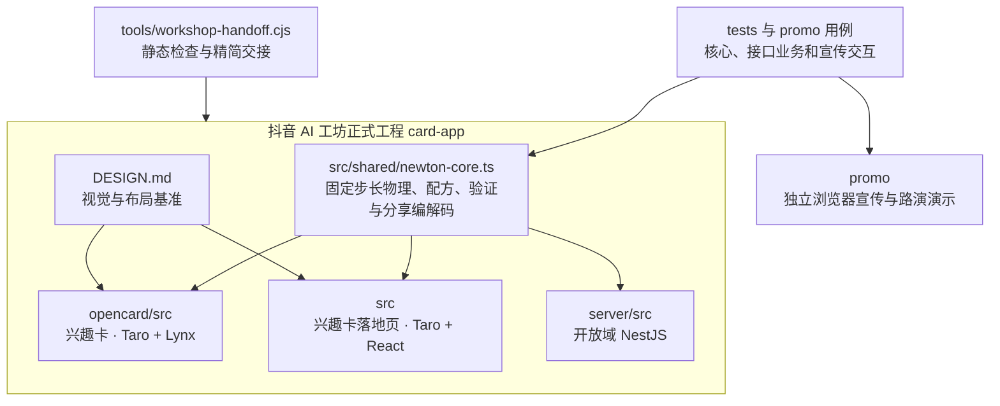

# 《牛顿哭了 3D》全栈架构白皮书

本文件说明当前工程的实现、精选桌出题链路和平台验收边界。产品承诺、取舍、赛程及里程碑以 [07 立项决议书](./07-牛顿哭了3D-最终定案立项决议书.md) 为准。具体视觉与布局以 [DESIGN.md](../card-app/DESIGN.md) 为准。

## 目录

1. [体验假设与测量](#体验假设与测量)
2. [场景物理与视觉基线](#场景物理与视觉基线)
3. [AI 出题与运行协议](#ai-出题与运行协议)
4. [战果、接力与榜单](#战果接力与榜单)
5. [工程拓扑与平台交接](#工程拓扑与平台交接)
6. [商业化验证口径](#商业化验证口径)
7. [交付证据](#交付证据)

## 体验假设与测量

胖橘推杯、道具临近盘沿、指尖一拍改变结果，是对信息流低摩擦交互的设计假设。项目采用短字、图标和物理动作，兴趣卡与兴趣卡落地页全程零软键盘。热身滑向盘沿的动画编排为 `54 / 60 = 0.9s`。点按到首个可见反馈 `<100ms` 是真机测试目标。滑到盘沿的模拟时间、页面实际帧率、用户理解所需时间是各自独立的量。

原稿借鉴了救援玩法的易理解、合成玩法的组合探索、旋转猫的短视频表现和 Wordle 式无剧透战报。旧稿中的注意力时长、通关率和增长系数用于早期创意说明，当前无实测依据。源码中 `LEVELS.passRate` 的 `99.2` 与 `6.8` 是配置值。本地可用固定种子检查同一个动作是否能产生预期变化。观察玩家是否看懂时记录他们实际首击的目标、是否完成一局、失败后能否同题重试。线上有合规曝光事件时可统计有效曝光到首次主动点按的比率。只有页面就绪事件时，以已就绪会话作分母并明确命名。 [共享物理与关卡配置](../card-app/src/shared/newton-core.ts)

## 场景物理与视觉基线

### 关卡与道具

共享核心以固定 `1/60s` 步长推进，圆盘半径 `2.45`，初始状态含五个主体。核心处理球体接触与扫掠碰撞、桌面反弹、法则施力及连锁计数。下面四个场景及默认道具已存在于正式核心。

| 场景 ID | 默认道具 | 可见物理反馈 |
| --- | --- | --- |
| `warmup` 猫推冰美式 | `coffee` | 咖啡杯滑向盘沿。点杯或法则改变飞行轨迹，杯子能够撞击积木，落回盘内站稳或跌出。 |
| `heavy_fish` 手机千斤砸 | `phone_case` | 手机自由下落并反弹，达到接触条件时冲击传给邻近物件。 |
| `jelly_party` 爆满硬塞箱 | `luggage` | 果冻状态改变盘沿接触与反弹，触发收纳箱的挤压反馈。 |
| `wig_orbit` 引力猫罐头 | `cat_can` | 同一北京时间日可取相同种子。旋风或特定反制激活径向引力，附近物体向罐头移动。 |

六个法则为反重力、果冻、旋风、放大、相斥和慢放。`REACTIONS` 定义了 12 组双法则图鉴。现有发现由法则匹配得出，本机收藏与固定图鉴编号可以展示玩家发现过哪些组合。衣橱包含墨镜、苹果帽、弹簧领结和卷发套。三次连续不同法则触发「陀螺橘」并把假发仪表推到 `999%`。冰美式热身局单独检查杯底接触、盘内余量、速度与杯身姿态。盘面对杯底的承托与结算采用同一边界，连续稳定 12 个物理帧才结算救回。掉出后结算失败，三招旋转或压哨出手都可以先发生。其他关卡沿用各自的快捷法则与物理判断。 [法则、图鉴与求解器](../card-app/src/shared/newton-core.ts)

### 共享视觉与画风小样

当前主视觉沿用奶油黏土玩具、橡木圆盘与黄铜仪表，法则主要用明亮色彩和形变反馈。事故用圆润玩具表达，避免伤害或惊吓表现。审核结论由平台实际流程确认。

首个画风小样可对照奶油黏土与黑白漫画，固定同一事故、种子、镜头、操作区域和物理结果，仅替换材质、色彩与描边，观察首击位置、关键道具辨识度及静音可读性。黑白小样用轮廓、剪影或不同纹理区分法则和结果。多画风是小规模验证项，正式视觉值和布局变更按 `DESIGN.md` 维护。 [正式视觉基线](../card-app/DESIGN.md)

## AI 出题与运行协议

### 当前的编译与导演

`POST /api/newton/compile-patch` 接收 `slots`、`levelId`、`seed`、`propSkin` 和有限的 `seenCodes`，返回带动作序列的 `PhysicsPatch`。当前三槽选的是主体、法则、时机。预审配方把「立即 / 落地时 / 盘沿边」映射到第 `0 / 20 / 54` 帧。这里的「落地时」采用固定帧，实际碰撞事件触发属于后续协议设计。前端播放 1.2 秒蓄能反馈，客户端和服务端各有 2800 ms 超时处理，失败后使用本地确定性配方。当前正式平台适配方法返回 `null`。 [落地页入口](../card-app/src/pages/index/index.tsx) · [服务端实现](../card-app/server/src/dy-card.service.ts)

`validateExternalPatch` 从至多 6 个候选动作里过滤无效项，允许 `gravity`、`bounce`、`kick`、`spin`、`scale`。动作帧限制在 `0..240`，通用数值钳制在 `[-1.5, 2.5]`，冲量各分量钳制在 `[-1.5, 1.5]`。`moveBody` 再把恢复系数限制在 `[0, 1.28]`，并约束缩放与姿态。输出保留本地的配方元数据和编号，模型质检短评经过清理。当前校验会接受结构合格的零力度动作，也可能接受与所选主体和时机不符的动作。它提供运行安全的数值约束。语义一致、题面可解和可见差异需要单独验收。 [补丁协议与执行器](../card-app/src/shared/newton-core.ts)

`POST /api/newton/director-react` 接收七个局内字段 `totalTaps`、`clutchCount`、`failStreak`、`chainTotal`、`lawCounts`、`propSkin`、`levelId`。服务端拒绝额外字段，采用 2200 ms 超时和本地导演回退。当前目录包含五种行为画像、候选配方和四种物理反制。`heavy_cup` 压低杯子、`reverse_wind` 改变横向速度、`slippery_rim` 改变表面阻尼、`can_gravity` 引入径向拉力。行为侧写仅基于交互统计。平台接入时仍需核对相关数据和授权要求。反制验收应比较同种子下惯用招式和替代招式的可见结果。 [NestJS 接口](../card-app/server/src/dy-card.controller.ts) · [导演及反制实现](../card-app/src/shared/newton-core.ts)

### 精选桌的试玩、定题与还原

玩家选宿舍或桌搭，再选保杯或保塔。每个地点有两种手调摆法，可在预览中换一桌。进入试玩后，第一次点法则或保护物启动模拟。不同摆法改变杯子的初速及倾角，两种摆法中失重与果冻的保杯结果互换。杯局要求连续 12 帧落稳；6 秒时若已开始站稳则允许继续确认，仍在翻滚会显示「杯子没稳住」。塔局检查积木是否实际倒下，杯子掉落后仍按塔的情况结算。作者亲手试到结果后才能定题。[精选桌面配置](../card-app/src/shared/table-challenge.ts) · [胜负判定](../card-app/src/shared/newton-core.ts)

定题分享只携带 `from=table`、`place`、`goal` 和 `v`，其中 `v` 选择该地点的第一或第二种摆法。接收端按这四项重建同一开场，等接题人点按；重开也回到原处。草稿阶段的分享打开普通首页。新增摆法时需保留已分享组合对应的位置和规则；跨手机实际打开须在抖音宿主验收。[落地页入口](../card-app/src/pages/index/index.tsx)

后续接入平台模型时，先让模型改变一项能看见的物理条件，用无操作和两种不同的招式试跑候选：风险看得见、至少一招可解，再交给作者试玩。不合格或超时立即给精选桌。生成题若超出内置摆法，要能在朋友设备上取回作者确认的那份参数，不能让接收端再次随机生成。

## 战果、接力与榜单

| 能力 | 当前实现 | 验收边界 |
| --- | --- | --- |
| 兴趣卡进入落地页 | 静态入口以北京时间当日种子开启「今日同桌」。有回调且已出招时生成动态路径，包含种子、首招、精确出手帧（`firstTick`）、道具、连锁数、能量和压哨毫秒数；落地页先确定性推进到 `firstTick` 再施加首招，并在结算后提供同拍「换一招」对照。 | 平台宿主需确实绑定动态路径，再核对参数与首招帧还原；只接静态入口时验证今日精选局与页内同拍换招。 |
| 好友接力与精选同题 | 分享参数含种子、配方、棒次等信息，另支持 `from=table` 的宿舍／桌搭（保杯／保塔）精选挑战路径。普通接力的冰美式停在第 54 帧盘沿，其他关卡取自然翻车前 30 帧。精选题统一停在自定义摆台第 0 帧。两种接力都等第一下出手，重开恢复各自的起点。 | 当前还原同种子的自然事故或精选桌面初态。跨设备打开还需通过宿主原生分享实机核对。 |
| 六格战报 | `formatWordleReceipt` 整理最近六个法则色块，落地页附道具、连锁和质检短评，采用模型补丁时显示 `AI 生成`。 | 在工坊核对实际模型与本地回退的不同显示，以及平台对生成内容和分享素材的标识要求。分享与局内领奖保持独立。 |
| 省队榜 | `POST /api/newton/squad-boost`（`@HttpCode(200)`）保留进程内限幅累计能力，参赛首版通过 `isSquadEnabled` 默认关闭省队入口，仅保留战报与分享。 | 目前仅作可选演示，首发默认收起。正式启用需补独立读取、可信成绩、幂等原子计数和云库持久化。 |
| 衣橱、图鉴、纯净模式 | 服饰、已发现反应和配方标识由客户端本地保存。`enableRetention` 与 `enableSocial` 控制相关入口，落地页可收起部分操作界面。 | 本地收藏与纯净展示可各自验证。系统录屏、原生分享和二创入口需按真实平台能力确认。 |

验证用例需覆盖首个有效结果、重复打开同一题面、好友换招、失败后复玩。若后续增加实际残局恢复，应另测发送方非空动作、不同反制和恢复后后续轨迹。 [兴趣卡入口](../card-app/opencard/src/index.tsx) · [分享与渲染入口](../card-app/src/pages/index/index.tsx) · [现有测试](../tests/newton-core.test.cjs)

## 工程拓扑与平台交接

### 正式双端与宣传站

| 维度 | 兴趣卡 | 兴趣卡落地页 | 独立宣传站 |
| --- | --- | --- | --- |
| 渲染 | Lynx，当前为 2.5D CSS／View 舞台。 | 常驻 Canvas WebGL V2，`@open-dy/threejs` 与可互动的预览舞台。 | 浏览器 3D 透视绘制，离线资源与单独的 JavaScript 核心。 |
| 容器 | `300 / 436` 两档核对，保留宿主壳与 Body 的唯一 Actual FMP，无纵向滚动、无 `@media`。 | 竖屏舞台、常规 Taro 组件与底部抽屉，需核对导航安全区。 | 独立响应式站点与路演录制，根目录物理隔离。 |
| 输入 | 直接点杯、三颗法则胶囊与同题重开。 | 点物件或法则出手。单指环绕、抬低镜头，双指缩放。自由摆弄支持拖动、抛放、双指拧转和翻面。 | 三槽点选、拖拽环绕，桌面端可输入一句话做本地规则演示。 |
| 生命周期 | 有界推进，组件卸载清理定时器。宿主切流时的行为待验证。 | `useDidHide` 停止帧调度，`useDidShow` 恢复，卸载释放场景。 | 支持离线运行，视频与 PNG 导出受浏览器能力影响。 |

宣传站的本地编译器与可玩演示可以用于录制和对照素材。它不能提供正式落地页、平台模型调用或真机手势的验收证据。 [落地页渲染入口](../card-app/src/pages/index/use-toybox-3d.ts) · [独立宣传站](../promo/index.html)

落地页让两种渲染共用一套相机参数。原生画布按当前相机对可见模型做射线拾取，回退舞台按同一视角投影和排序，由可见玩具图形接收触摸。手势跟踪从舞台开始的触点，拖动、捏合和中断都会取消这次轻点。进入自由摆弄时复制物件姿态，原挑战时钟暂停。拖动沿相机平面映射到世界坐标，翻转围绕物件本身。退出时恢复挑战帧、待施力规则、等待首招的状态和原镜头。自由操作无需写入同题分享参数。 [手势仲裁](../card-app/src/pages/index/touch-gestures.ts) · [相机与投影](../card-app/src/pages/index/toybox-camera.ts) · [自由摆弄](../card-app/src/pages/index/toybox-play.ts)

### 交接包、模板和素材

从仓库根运行 `pnpm run handoff` 生成 `dist/handoff.zip` 和 `dist/HANDOFF_PROMPT.md`。压缩包按 `card-app/` 相对位置交接业务源码、实际使用的素材、`DESIGN.md` 和合并说明 `README.md`。回工坊后先解压至临时目录，再向现有模板合并。保留模板的网络封装、基础依赖配置、路由骨架与 FMP。依赖声明、锁文件、构建产物、密钥、宣传站与模板基础配置均在包外。生产运行依赖按模板规则局部登记。交接包对超过 5 MB 的素材列出另行转存项。线上图片由平台工具转存，背景图和器乐 BGM 在宿主 Feed 外壳配置，BGM 由宿主播放。 `dist-tt` 与 `opencard/dist` 各自按平台规范检查不超过 16 MB。 [官方外部开发链路](./00-官方外部开发与交接链路规范.md) · [交接工具](../tools/workshop-handoff.cjs)

| 平台接入位置 | 回工坊后的核对 |
| --- | --- |
| `opencard/src/index.tsx`、`opencard/src/types.ts` | 使用模板网络层读取 `GET /api/dy_card/data`。在支持动态入口的宿主上接入 `onHandoffReady`。 |
| `src/pages/index/use-toybox-3d.ts` | 在抖音真机等候好友局时绕到盘后、缩放，进入自由摆弄抓杯扭转、甩放、翻面，再返回原视角点第一招。抓持中切后台后恢复，检查无误投、底栏可点，并测首个可见反馈。 |
| `src/pages/index/index.tsx` | 核对平台批准的网络入口和原生分享。参赛版收起商业入口，调配额度用尽后仍能使用内置配方。 |
| `server/src/dy-card.controller.ts`、`dy-card.service.ts` | 在模板根模块接入 `DyCardModule` 与全局 `api` 前缀。按平台 `ai-platform-llm-skill` 接入编译和导演，核对超时后的回退与任务取消。 |
| `feed/feed-card.json`、`config/card-routing.json` | 在平台完成背景转存、宿主 BGM、路由和基础信息回读。`PageIndex` 与 `PageURL` 采用无前导斜杠的页路径。 |

## 商业化验证口径

模型调用路径目前位于落地页，兴趣卡的首轮交互由端侧物理执行。原稿按曝光、进入率、AI 触发率和单次模型费用估算，属于场景假设。等平台接入后，按每个有效会话分别计编译与导演请求数、实际完成和回退、可用生成率、请求耗时和实际计费。前端每日三次服务调配额度覆盖本机炼金，导演另有触发点。额度用完可立即玩内置配方，掉杯可直接重试。参赛版没有广告或商品转化收入数据。

四种道具可展示商品表现如何映射到物理事件，例如手机撞击传导至桌面、罐头产生引力。展示行为由游戏参数控制。品牌看中哪种场景、换皮耗时及精选联盟或其他跳转权限需要独立试点。

## 交付证据

2026 年 11 月 23 日，本地以正式落地页组件和模拟宿主输入走通两条路径。WebGL 与回退舞台都能从待开局状态环绕、缩放，进入自由摆弄抓杯、拧转、翻面，退出后恢复原视角和摆放。抓持中模拟切后台、恢复时迟到的抬指以及变更舞台宽高，也分别走通。另一组从作者试玩页发起分享回调，用独立页面打开返回的题面并重试。320×520 的落地页模拟视窗里，双物件结算及换招时仍留有 288×288 的舞台。对应的抖音宿主触点与真机反馈另行实测。

本地测试覆盖确定性轨迹、碰撞与防穿透、补丁钳制、模拟超时、分享编解码、近似恢复的相关数据和打包约束。精选桌另核对作者与接题人的独立页面初态、不同招式的结果和同桌重试。模型真调用、两档宿主槽高、真机反馈时间、跨设备原生分享及生产持久化仍待留证。报告将本地行为、平台预览、真机、公开流量和商业结算各自标明。全流程的优先级、推进节点和参赛取舍维护在 [07 立项决议书](./07-牛顿哭了3D-最终定案立项决议书.md)。

## 附录｜文档与代码索引

- 平台规范：[00 外部开发与交接链路](./00-官方外部开发与交接链路规范.md) · [01 项目要求与接入](./01-项目要求与接入规范.md) · [02 排除方案与交互红线](./02-已排除方案与反模式红线记录.md) · [04 工程规格与容器红线](./04-工程规格与容器红线.md)
- 产品决策与历史参考：[07 现行立项决议](./07-牛顿哭了3D-最终定案立项决议书.md) · [09 V2 前端重构与 3D 视觉设计白皮书](./09-牛顿哭了3D-V2前端重构与3D视觉设计白皮书.md) · [03 共创全景指南](./03-三轮深度共创全景指南.md) · [06 创意来源与试播手册](./06-牛顿哭了3D-互联网爆款基因与产品总纲.md)
- 源码：[视觉基准](../card-app/DESIGN.md) · [物理核心与协议](../card-app/src/shared/newton-core.ts) · [兴趣卡](../card-app/opencard/src/index.tsx) · [兴趣卡落地页](../card-app/src/pages/index/index.tsx) · [后端服务](../card-app/server/src/dy-card.service.ts) · [宣传站](../promo/index.html) · [本地脚本入口](../package.json)
