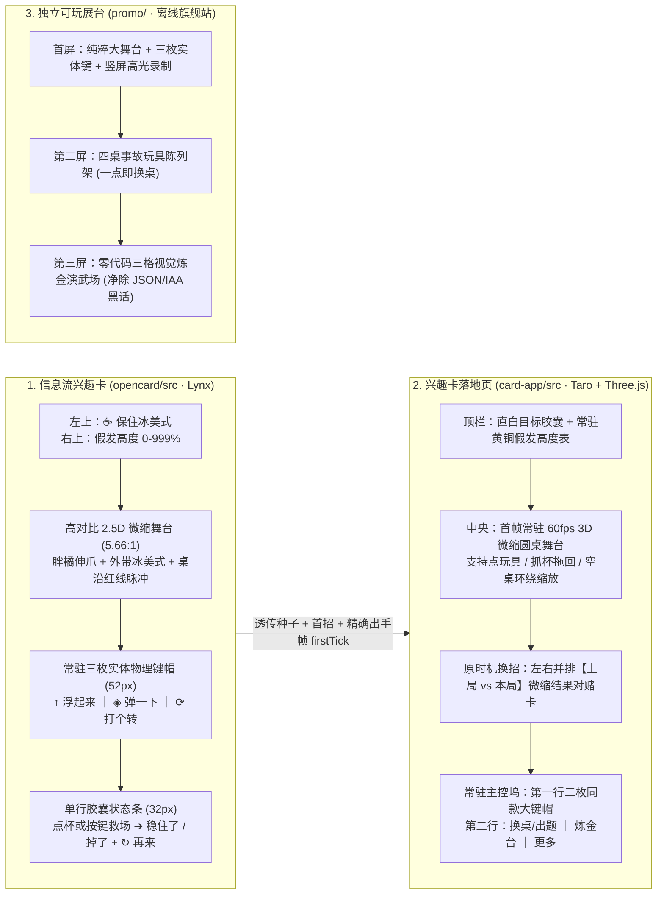

# 《牛顿哭了 3D》V2 前端架构、程序化 3D 建模与人类直觉排版重构白皮书

> **文档定位**：本白皮书由 **Gemini 4 Carbon × GPT-6.2-Astra** 双核深度调研共创产出，针对 V1 版本“前端界面杂乱费解、3D 建模粗糙失真、文字排版反人类直觉”的核心痛点，结合国际顶尖开源/独立交互小项目进行系统性拆解，给出覆盖 **`card-app/opencard/src/`（信息流兴趣卡）**、**`card-app/src/`（兴趣卡落地页）** 与 **`promo/`（独立可玩演示站）** 的完整 V2 重构设计规范与工程执行蓝图。  
> **配套基准**：双端正式视觉规范已同步写入 [`card-app/DESIGN.md`](../card-app/DESIGN.md)；产品赛程见 [`07 立项决议书`](./07-牛顿哭了3D-最终定案立项决议书.md)；物理与服务端协议见 [`08 全栈架构白皮书`](./08-牛顿哭了3D-完整项目理论与全栈架构白皮书.md)。

---

## 一、 V1 为什么“完全不能让人满意”：六大反人类病灶全量诊断

通过对 V1 实测渲染图（[`docs/assets/v1-3D手势实测.png`](./assets/v1-3D手势实测.png)）与三端全部样式/渲染源码的逐行审计，V1 的问题并非单点瑕疵，而是**视觉对比度坍塌、主操作被折叠隐藏、跨端 3D 建模精神分裂、样式表前后打架、文案黑话化**五重失误叠加的结果：

| 病灶维度 | V1 源码与实测铁证 | 为什么违背人类直觉理解 |
| :--- | :--- | :--- |
| **1. 图底对比度坍塌（1.45∶1 米黄糊成一片）** | 兴趣卡舞台 `#F8EBD6` 配木盘 `#E9BF8B`（对比度仅 **`1.45∶1`**）；落地页背景 `#F6EFDE` 配木盘 `#DDB584`（实测图几乎融为同一种浅米色）。 | 人类视觉需要 **≥ 3.5∶1** 的图形边界对比才能在 `0.2s` 内分辨“桌面边界”与“桌外深渊”。V1 米白盘浮在米白底上，毫无悬崖落差感，看不出“掉下桌沿”的紧迫危机。 |
| **2. 核心玩法被藏进二级抽屉（最大交互败笔）** | 落地页 `ToyboxPage` 默认进入 `house` 首桌，底部仅放 `拖空桌转视角 \| ↻ 重开 \| ✧ 小魔法 \| ··· 更多`，**把最核心的三颗物理法则键帽全部锁进 `✧ 小魔法` 弹窗**，且 `wigLiftPct > 0 && !table` 导致首桌全程不显示黄铜表盘（[`src/pages/index/index.tsx:710-745`](../card-app/src/pages/index/index.tsx#L710-L745)）。 | 玩家刚在兴趣卡学会按三颗物理键救杯，点进落地页却发现按钮全没了，只剩一句莫名其妙的平铺小字。核心爽感入口被自己藏了起来。 |
| **3. 3D 建模比例失调、跨端货不对板且杂物喧宾夺主** | ① `WORLD_WIDTH = 6.05` 下主角杯子半径仅 `0.22`（占画幅宽仅 `7%`），转视角时直接被胖橘脑袋挡没；② 兴趣卡画的是**透明外带冰美式**，落地页 `toybox-scene.ts:194` 却画成**深青色陶瓷带把马克杯（`#307e74`）**；③ 钢琴、拉面碗、积木塔、猫、杯子 5 个物件无差别全堆在盘上，且 `MeshStandardMaterial` 灰暗塑料感严重。 | 主角太小看不清、跨端换了杯子认不出、无关摆件抢戏导致第一眼不知道该救谁；缺乏黏土玩具的轮廓描边与通透高光，观感像早期粗糙几何体测试。 |
| **4. 样式表首尾两套主题互相覆盖** | [`src/pages/index/index.css`](../card-app/src/pages/index/index.css) 第 `1–178` 行定义暖棕圆角风格，第 `180–214` 行又硬贴一套灰绿直角 `.toybox` / `.hand-dock` 覆盖规则，导致抽屉是暖棕、顶栏是墨绿、底栏是灰白平条。 | 整个页面像两个半成品拼凑，缺乏统一的现代设计系统与层次秩序。 |
| **5. 文案黑话化、排版拥挤难读** | 兴趣卡同时挤入 `8px–12px` 小字与无交互的内部状态词「同桌首招」；落地页换招对照写成单行天书 `上轮↑ 杯子稳住、积木塔倒了 · 这轮≈ 进行中`。 | 人类不想做符号解码阅读理解！法则叫“反重力/果冻化”不如直觉动词 **「↑ 浮起来 / ◈ 弹一下 / ⟳ 打个转」** 好懂；两局对比应该看**左右两张结果小卡**，而不是读一串符号。 |
| **6. 宣传站做成 B2B 开发者后台** | [`promo/index.html`](../promo/index.html) 首屏同时出现三个竞争性开始按钮、坐标轴 `Y↑ X`、底部大片原始 JSON `<pre id="patch">PhysicsPatch</pre>` 代码框以及 `IAA / 单次 AI 编译 <¥0.005` 成本测算文字。 | 彻底破坏了物理玩具的纯粹好奇心与消费级高级感，让普通观众一眼产生“这是内部工程调试台”的排斥感。 |

---

## 二、 顶尖开源与独立前端交互小项目深度对标与技法吸收

为确保 V2 前端界面与 3D 表现达到真正令人眼前一亮的水准，我们系统拆解了 6 个国内外公认标杆级的开源/独立 Web 交互与轻量 3D 项目，并将其核心机制转化为兼容 **抖音 Lynx + Taro `@open-dy/threejs`（包体 `≤16MB`，零重型外置 GLB 依赖）** 的工程方案：

| 标杆项目 / 作者 | 核心交互与视觉精髓 | 吸收进《牛顿哭了 3D》V2 的具体落地机制 |
| :--- | :--- | :--- |
| **1. Neal.fun**（*Infinite Craft* / *Draw a Perfect Circle*，Neal Agarwal） | **Single Clean Verb（单动词直觉）+ Toy-Shelf 留白**：零教程弹窗、零工程术语，标题即任务，主画布居中留白，次级场景做成一目了然的“玩具陈列格”。 | ① 废除一切内部术语（删掉 `PhysicsPatch`、`同桌首招`、`违禁物理胶囊`）；② 首屏只留**一个明确目标胶囊 + 一座高对比舞台 + 三枚直接可按的动作键**；③ `promo/` 与落地页换桌采用“玩具陈列架”卡片，每张直白写清事故（如「猫推冰美式」「硬塞行李箱」）。 |
| **2. Josh W. Comeau《3D Pushable Tactile Button》** | **三层物理键帽解剖学 + 非对称弹簧时序**：将按钮拆为固定阴影层（Shadow）、立体侧壁（Edge）、可动键面（Front），仅对键面做 `translateY` 位移；**按下 `34ms` 瞬时到底，松手 `280ms` 弹性回弹**。 | 三端主键统一升级为 **3px 物理行程三层实体键帽**：手指触碰瞬间（`34ms`）键面立刻砸下，杯体同步发生形变，松手后沿弹性曲线回弹，连按同键无需等动画播完即可重触发。 |
| **3. Karim Maaloul / Yakudoo**（开源 Three.js 名作 *Chill the Lion* / *Cat vs. Ball of Wool*） | **程序化几何体的灵魂 = Q 版头身比 + 眼神追踪 + 情绪夸张形变**：完全不靠复杂贴图，仅凭大头宽腮比例、实时追踪目标的瞳孔与受惊放大的眼白，就让基础几何体拥有活物般的生命力。 | 重构 `toybox-scene.ts` 中的胖橘模型：**头宽放大至躯干 `1.22×`**，前爪肉垫真实探出抵住杯身，植入 **4 态实时表情联动**（推杯坏笑盯杯 → 浮空圆眼受惊 `O_O` → 果冻眯眼压扁 → 陀螺橘晕眩转圈）。 |
| **4. Bruno Simon**（*Three.js Journey* / *folio-2019* 开源微缩场景） | **等轴测切面 Diorama（微缩盒景）+ 程序化暖色阶烘焙光感 + 接触软影（Contact AO）**：把孤立地面做成带厚度的立体切面岛屿，用冷暖环境光对冲塑造体积感。 | 抛弃单薄扁圆片！将舞台升级为 **深蓝灰摄影棚井（`#364D58`）托举的暖蜜橡木厚切面圆桌（`#F3C78C` 桌面 + `#B87A4B` 倒角侧壁 + `#674529` 悬崖底沿 + 桌下深渊投影）**，一眼建立立体高度差。 |
| **5. David DeSandro《Zdog》& `sloemo01/diorama`**（GitHub 开源伪 3D / 描边盒景套件） | **圆润饱满轮廓 + 背面法线外扩柔和描边（Inverted-Hull Toon Outline）**：在浅色或复杂背景下，给主角套一层 `1.045×` 深可可色背面壳（`THREE.BackSide`），小屏辨识度瞬间翻倍。 | 在 `@open-dy/threejs` 与 `promo/stage3d.js` 中，为**胖橘躯干/头部**与**外带冰美式杯体**加入轻量级深可可色（`#2B1B17`）柔和轮廓描边 + **3 阶黏土明暗渐变贴图（Procedural Clay Ramp `DataTexture`）**，彻底告别灰暗塑料感！ |
| **6. Matter.js 开源弹射玩具 & *Suika Game* 临界反馈** | **临界危险线可视化（Redline / Rim Pulse）**：玩家必须清楚知道“越过哪条线就算输”，临近越界时边界给出呼吸脉冲预警。 | 在桌面事故侧边缘雕刻 **3 道黄铜/绯红刻度槽 + 动态临边危险弧（Hazard Rim Arc）**：当杯底距盘沿不足 `0.65` 世界单位时，对应方位的桌沿弧段亮起珊瑚橙红警示光，静音秒懂险情！ |

---

## 三、 V2 三端前端模板架构设计（100% 符合人类 0.2s 直觉理解）

### 3.1 信息流兴趣卡模板重构（`card-app/opencard/src/`）
严格遵守字节 **Lynx 渲染红线**（禁 `@media`、禁纵向滚动、禁 `@open-dy/lucide-taro`、禁自播音频、保留 `.widget-root` 与 `.widget-body` 唯一真实 Actual FMP）：

1. **首帧构图铁律（静音 0.2s 秒懂）**：
   - 废除 V1 小如指甲盖的 `26px` 窄杯与浅米色背景；将舞台背景设为深蓝灰摄影棚色 `#364D58`，暖橡木厚桌面偏左下方排布，**右侧与右下角留出明显的深色悬崖落差空隙**。
   - **放大主角因果链**：胖橘位于舞台左中（宽约 `76px`），伸出带粉肉垫的右前爪直接抵住右侧三分之一处的**大号外带冰美式**（宽约 `44px`、高约 `68px`，带白盖、深咖液面、两块冰、牛皮纸套、斜绿吸管）；桌沿右侧刻有 3 道危险短线，杯子滑近时点亮珊瑚红警示条。
   - 远景积木与发条琴缩小并降低对比度退居左上背景，绝不干扰「猫爪 → 冰美式 → 悬崖桌沿」视觉焦点。
2. **`300px / 436px` 双槽高精准像素预算表（单棵 DOM 树纯 Flex 伸缩）**：

| 纵向分区 | `300px` 槽高 | `436px` 槽高 | 伸缩策略与人类可读性保障 |
| :--- | :---: | :---: | :--- |
| `.widget-root` 外框与上下内距 | `22px` | `22px` | `1px` 边框 + 上下各 `10px` 内距，四角 `12px` 圆角瓷白半透底板 |
| `.newton-stage` 微缩桌面舞台 | **`180px`** | **`316px`** | `flex: 1; min-height: 180px; max-height: 316px`；左上叠放「☕ 保住冰美式」，右上叠放「假发高度」 |
| 舞台与键帽行间距 | `8px` | `8px` | 固定 `margin-top: 8px`，防止阴影与键帽粘连 |
| `.quick-row` 三枚常驻实体键帽 | **`52px`** | **`52px`** | `flex-shrink: 0`，三等分大热区：`↑ 浮起来`、`◈ 弹一下`、`⟳ 打个转` |
| 键帽行与状态条间距 | `6px` | `6px` | 固定防误触安全留白 |
| `.card-result` 单行结果与重玩条 | **`32px`** | **`32px`** | 初始「点杯子或按键救场」；结算后「✓ 冰美式稳住了 / ✕ 杯子掉下桌了」+ 独立「↻ 再来」按钮 |
| **总计** | **`300px`** | **`436px`** | 零裁切、零重叠、零滚动，高槽多出的 `136px` 全部用于舒展舞台空间感 |

### 3.2 兴趣卡落地页模板重构（`card-app/src/pages/index/`）
彻底清除 `index.css` 末尾冲突的灰绿覆盖补丁，建立单手直觉操作布局：

1. **顶部清爽双胶囊 HUD（`stage-hud`）**：
   - 左侧：**高对比目标主标题**（如 `☕ 保住冰美式` / `🧱 护住积木塔`；若来自卡片接力或好友定题，上方附一枚清脆绿签 `接着救杯` / `好友出的题`）。
   - 右侧：**全模式常驻紧凑黄铜小表**（`假发高度 0%–999%`，修复 V1 默认首桌看不见仪表的割裂感，固定 4 字符数字宽度）。
2. **中央高对比 3D 微缩玩具舞台（`stage-space`）**：
   - 深蓝灰径向柔光摄影棚底衬托暖蜜橡木厚圆桌；空桌拖动旋转视角后，右上/底角柔和浮现「↺ 视角回正」胶囊（未转视角时不刷废话提示干扰画面）。
3. **结算「上局 vs 本局」可视化双小卡对照（替代单行符号串）**：
   - 当玩家点击替代法则从原出手帧重演对比时，在舞台下方并排展示两张一目了然的小卡片：
     - 左卡（浅灰底）：`上局 · ↑ 浮起来` → **「✕ 杯子掉了」**
     - 右卡（高亮底）：`本局 · ◈ 弹一下` → **「✓ 杯子稳了」**（物理未停稳前显示 `… 还在空中`）
4. **底部常驻双层主控坞（`dock`）——把核心爽感放回首屏！**
   - **主操作层（常驻三枚大号实体物理键帽，高 `96rpx`）**：`↑ 浮起来`（青）、`◈ 弹一下`（青柠）、`⟳ 打个转`（紫），外加结算态一键显眼的 `↻ 再来` / `下一桌`。玩家进页无需翻任何菜单，手指一按即刻施法！
   - **次级工具层（精简三入口，高 `64rpx`）**：
     1. **`🎲 换桌 / 出题`**：合并四桌精选场景玩具架（猫推冰美式、防摔机砸桌、爆满硬塞箱、引力猫罐头）与两步为朋友出题（选宿舍/桌搭 → 选保杯/保塔 → 试玩定题分享）；
     2. **`⚗ 炼金台`**：零键盘三槽点选（选谁 × 施什么魔法 × 什么时机），编译按钮文案改为人话 **「✦ 试试这招」** 与 **「🐾 胖橘出一题」**；
     3. **`··· 更多`**：收纳「自由摆弄」「进阶法则（放大/弹开/慢放）」「胖橘衣橱」「反应图鉴（12 种）」「战报小票」「纯净录屏」与「设置」。

### 3.3 独立宣传与路演演示站重构（`promo/`）
与 `card-app/` 保持根级物理隔离与零外网依赖，从“开发者参数后台”蜕变为 **Neal.fun × Apple Arcade 级纯粹可玩 3D 展台**：
- **第一屏（Hero Playable Stage）**：左侧极简大字标题「牛顿哭了 3D — 猫爪刚松开，这杯冰美式你保得住吗？」+ 单一主召唤动作；右侧超大实时 3D 摄影棚舞台 + 底部三枚同款物理大键帽 + 右上角一键「🎬 竖屏高光录制 / 高清抓拍」（进入录制自动净空全部 UI 外框）。
- **第二屏（Toy Shelf 四桌事故陈列架）**：4 张高颜值微缩事故卡片（冰美式临边、防摔手机震桌、爆满行李箱弹开、猫罐头强引力），点任意一张立即滚回舞台切换实景开玩。
- **第三屏（Visual Rule Mixer 三格魔法调配器 + 12 反应盲盒墙）**：保留零打字三格图标组合并直接在舞台上演绎连锁反应，**彻底删除裸露的 `PhysicsPatch` JSON 代码块、删除 `IAA <¥0.005` 商业算账小字与冗余工程开关**，让观众全程沉浸在物理玩具的惊喜中。

---

## 四、 V2 程序化 3D 建模、黏土光影材质与物理果汁感规格书

在不引入外部重型 `.glb` 文件（确保小程序包体远低于 `16MB` 上限、离线秒开）且 **100% 保持 `newton-core.ts` 物理坐标、5 刚体结构与全部单测不变量零破坏** 的前提下，对 [`toybox-craft.ts`](../card-app/src/pages/index/toybox-craft.ts)、[`toybox-scene.ts`](../card-app/src/pages/index/toybox-scene.ts) 与 [`promo/stage3d.js`](../promo/stage3d.js) 实施全面升维：

### 4.1 材质与光影升维：Procedural Clay-Toon Ramp + 柔和深可可描边
1. **程序化三阶暖黏土明暗贴图（Procedural Clay-Toon / MatCap `DataTexture`）**：
   - 替代 V1 发灰发脏的默认 `MeshStandardMaterial`。启动时用不到 30 行代码生成 `64×4` 三阶柔和暖调色带纹理（受光面暖奶油高光 `1.08×` → 中间调纯正本色 `1.0×` → 背光面暖棕紫阴影 `0.74×`），配合 `MeshToonMaterial`（冰块与杯盖高光局部使用低粗糙高光材质），令每个曲面瞬间呈现手作软陶/潮玩盲盒质感！
2. **主角背面外扩轮廓描边（Inverted-Hull Soft Cocoa Outline）**：
   - 为**胖橘主体（头、身、耳、伸出前爪）**与**主角实验品（外带冰美式杯身、杯盖）**挂载共用几何体的 `MeshBasicMaterial({ color: '#2B1B17', side: three.BackSide })` 描边层（法线外扩 `1.045×`）。即使缩到手机小屏或录屏压缩，猫爪与杯壁的交界依然刀刻般清晰！
3. **摄影棚三点冷暖打光 + 贴盘动态接触软影（Contact AO）**：
   - 主光暖阳色 `#FFF2DA`（左上前 `[-3.2, 6.5, 4.8]`）、冷青补光 `#B8E4F0`（右侧 `[4.2, 2.5, 2.8]` 勾勒冷色暗部层次）、琥珀逆光轮廓 `#FFD996`（后方 `[0.8, 4.2, -4.5]`）；
   - 每个玩具底部的柔和接触影随离盘高度 `lift` 实时缩小并淡出，玩家仅凭“杯底与影子的距离”就能精确判断浮空高度与落点！

### 4.2 核心角色与道具 V2 几何配方表

| 3D 资产 | V1 问题 | V2 程序化建模配方（`toybox-craft.ts` + `toybox-scene.ts`） |
| :--- | :--- | :--- |
| **1. 厚切面悬崖圆桌 Diorama** | 扁平浅米色圆片，无桌沿危机感 | ① 桌面：暖蜜橡木程序化柔和年轮木纹（`#F3C78C`）+ 桌心缝线软胶猫爪垫；② 桌体：加厚多层立体切面（倒角橡木中层 `#C4834E` + 暗胡桃厚底沿 `#674529` + 桌底大范围深色落差投影）；③ **动态临边危险弧（Hazard Rim Arc）**：沿盘沿 `r = 2.36` 布置刻度环与一段 `56°` 动态警示弧，自动朝向主角实验品方位 `atan2(z, x)`，当半径 `> 1.72` 时由暗铜转为珊瑚红高亮脉冲。 |
| **2. Q 版灵动胖橘（Hero Cat）** | 三球堆叠、小豆眼呆滞无反应 | ① **Yakudoo Q 版比例**：宽圆梯形萌猫头（宽 `1.08`、高 `0.82`）配饱满梨形坐姿躯干与奶油胸毛围脖；② **立体折耳与肉垫推爪**：双层圆角三角耳（外橘 `#E58538` + 内粉 `#F4A396`），近杯侧前爪向前大幅探出并雕出粉嫩掌垫；③ **4 态表情联动**：推杯时半眯坏笑且瞳孔实时锁定杯子坐标；触发「浮起来」时双眼放大 `1.32×` 呈圆眼受惊态；触发「弹一下」时身体随物理 Squash 扁平回弹；触发「陀螺橘」时瞳孔反向旋转并升起旋风圈。 |
| **3. 统一外带冰美式（Hero Coffee）** | 落地页画成深青色陶瓷马克杯，小且违和 | **三端 100% 统一为标志性外带冰美式，视觉尺寸放大 `1.36×`，并附 `r = 0.42` 隐形宽松触控拾取球**：① `LatheGeometry` 微锥形清透感杯壁 + 纵向奶白玻璃高光窄条（规避移动端多层半透明排序穿插 Bug）；② 内部深烘浓缩液面（`#3D2219`）+ 金棕油脂圈（`#D89A5B`）随倾角惯性微晃；③ 3 块圆角半透浮冰（`#C9EEF2`）；④ 中腰瓦楞牛皮纸防烫杯套（`#E6B87D`）；⑤ 奶白厚扣盖（`#FFFDF9`）+ `18°` 斜插抹茶绿吸管（`#56C271`）。 |
| **4. 其余三件实验品与积木塔** | 色彩灰暗、辨识度低 | ① **防摔手机壳**：高饱和薄荷青四角气囊防摔边框 + 深邃镜面屏斜向高光带 + 双摄模组；② **引力猫罐头**：银亮马口铁罐身 + 鲜橙三文鱼腰封 + **顶部翘起立体拉环** + 开启引力时底部扩散磁力环；③ **硬塞收纳箱**：莓果粉圆角硬壳箱 + 鼓胀中缝 + 明黄/青绿十字绑带 + 拉杆万向轮；④ **积木塔**：4 块大倒角包豪斯原木彩砖（赤陶红、暖赭黄、松石绿、奶油拱顶），倒塌与稳立姿态对比鲜明。 |
| **5. 焦点降噪机制（严守物理不变量）** | 5 件玩具全抢戏，画面杂乱 | **物理层不动**：`newton-core.ts` 的 5 个刚体（`cat / apple / noodle / piano / blocks`）坐标、质量、碰撞与全部单元测试保持 100% 原样；**表现层智能聚焦**：在单目标挑战局（如「保杯」或「保塔」）中，非本局核心的次要摆件（发条琴、拉面碗）自动缩小至 `0.78×` 精致桌面小摆件比例并收敛高光，一旦进入「自由摆弄」或对应关卡立即恢复全尺寸高光互动！ |

---

## 五、 人类友好型字体排版（Typography）、色彩对比度与人话文案系统

### 5.1 WCAG AA+ 实算高对比度色板（全量正文对比度 ≥ 4.5∶1）

| 语义 Token | 色值（Hex） | 适用范围 | 实算对比度与可读性说明 |
| :--- | :---: | :--- | :--- |
| `--bg-page` / `--bg-surface` | `#F2F6F5` / `#FFFFFF` | 页面外壳底色 / 底部主控坞、对照小卡与抽屉面板 | 清爽冷瓷白，彻底告别发黄陈旧感 |
| `--ink-primary` | `#172B32` | 主标题、目标文案、键帽主字、结算结果 | 对 `#F2F6F5` 达 **`13.50∶1`**（AAA 级极高清晰度） |
| `--ink-secondary` | `#475A60` | 次级入口、表盘小标、辅助状态说明 | 对 `#F2F6F5` 达 **`6.65∶1`**，对 `#FFFFFF` 达 **`7.24∶1`**（严禁再用整组低透明度冲淡小字） |
| `--stage-well` / `--wood-top` / `--wood-cliff` | `#364D58` / `#F3C78C` / `#674529` | 摄影棚舞台井 / 暖蜜橡木桌面 / 悬崖厚前沿 | 木盘对舞台井对比度达 **`5.66∶1`**（较 V1 的 `1.45∶1` 提升近 4 倍！） |
| `--law-lift`（↑ 浮起来） | `#9CE8ED`（底）/ `#4CA8B0`（底边） | 第一主键帽与浮空特效环（配 `#172B32` 字） | 键面文字对比度 **`10.63∶1`** |
| `--law-bounce`（◈ 弹一下） | `#CBED8E`（底）/ `#7EA83B`（底边） | 第二主键帽与果冻波纹环（配 `#172B32` 字） | 键面文字对比度 **`11.23∶1`** |
| `--law-spin`（⟳ 打个转） | `#D7C4FA`（底）/ `#8468BA`（底边） | 第三主键帽与旋风轨迹弧（配 `#172B32` 字） | 键面文字对比度 **`9.22∶1`** |
| `--state-danger` / `--state-saved` | `#92351F` / `#226248`（配 `#FFFFFF` 白字） | 盘沿危险提示、掉落结算胶囊 / 救回成功胶囊 | 白字对比度分别为 **`7.63∶1`** 与 **`7.22∶1`** |
| `--brass-surface` | `#ECD19A`（配 `#8F6534` 边与 `#172B32` 字） | 右上角「假发高度」黄铜微缩表盘 | 表盘数字对比度 **`9.91∶1`** |

### 5.2 四级清晰字阶表（杜绝 `<12px` 蚂蚁字与多字号乱跳）

- **字体栈**：优先调用系统高可读现代无衬线字体（`"PingFang SC", "HarmonyOS Sans SC", "MiSans", "Microsoft YaHei", system-ui, sans-serif`）；所有百分比、连击数强制开启等宽数字对齐（`font-variant-numeric: tabular-nums` + 固定最小槽宽），杜绝数字跳变引发文字抖动。

| 字阶等级 | 兴趣卡（Lynx px） | 落地页（逻辑 px / rpx） | 宣传站（Web px） | 字重 / 行高 | 硬性字数预算 |
| :--- | :---: | :---: | :---: | :---: | :--- |
| **T1 作品/场景主标题** | 宿主承载（卡内不重复） | `22px`（`44rpx`） | `clamp(36px, 4.2vw, 56px)` | `800 / 1.15` | 每行 ≤ 8 个汉字，单行不折行 |
| **T2 当前目标 / 结算大结果** | `15px` | `18px`（`36rpx`） | `24px` | `700 / 1.25` | ≤ 8 字，一次只讲清一个目标或结果 |
| **T3 主键帽动词 / 对照卡标题** | `14px` | `16px`（`32rpx`） | `17px` | `700 / 1.25` | 主键固定 **3 字动词**，二级按钮 ≤ 5 字 |
| **T4 表盘标签 / 辅助短标** | `12px`（严禁小于 12px） | `13px`（`26rpx`） | `14px` | `600 / 1.35` | ≤ 6 字；数字槽固定预留 `999%` 宽度 |

### 5.3 全端“去黑话 → 人话直觉”文案重写对照表

| 位置 | V1 费解/工程味旧文案 | V2 人类直觉新文案 | 改写理由 |
| :--- | :--- | :--- | :--- |
| **三枚核心主键帽** | `反重力` / `果冻化` / `橘猫旋风`（落地页还藏进 `✧ 小魔法`） | **`↑ 浮起来`** / **`◈ 弹一下`** / **`⟳ 打个转`**（三端首屏常驻） | 用小学生 0.1 秒能脑补出画面动作的动词，直接对应物理反馈 |
| **开局引导提示** | `把杯子拖回桌中央` / `盯住猫爪，点实验品救场` | **`点杯子或按键救场`**（落地页附加轻提示：也可直接拖杯子） | 先给最零门槛的点按路径，拖拽作为进阶自然惊喜 |
| **右上角仪表名** | `牛顿假发离地表` / `物理崩坏值` | **`假发高度`**（配小卷发图标 + `0%–999%`） | 4 字干净利落，小屏不挤占主标题，笑点依旧直观 |
| **接力/同桌状态签** | `同桌首招` / `今日同桌`（常驻挤占兴趣卡底栏） | 兴趣卡底栏移除该静态词；落地页仅在接力时显示 **`接着救杯`** / **`好友出的题`** | 消除无点击功能的内部术语干扰，只在真正需要交代来源时说人话 |
| **原时机换招对比** | `上轮↑ 杯子稳住、积木塔倒了 · 这轮≈ 进行中` | 左卡：**`上局 · 浮起来 ➔ ✕ 杯子掉了`** 右卡：**`本局 · 弹一下 ➔ ✓ 杯子稳了`** | 双小卡视觉并列，因果对比一目了然，零阅读负担 |
| **炼金与出题入口** | `违禁物理胶囊` / `商业实验品一键换皮` / `AI 懂我定制局` / `PhysicsPatch` | **`换桌 / 出题`** · **`炼金台`** · **`✦ 试试这招`** · **`🐾 胖橘出一题`** · **`换个主角`** | 全面消费品化，彻底清除 B2B 广告黑话与代码类名 |

---

## 六、 审阅通过后的模块化重写执行清单与验收门禁

待您审阅确认本方案后，我们将严格遵循单写者隔离与契约不变量原则，按以下模块实施重写与全量验证：

1. **信息流兴趣卡重构（`card-app/opencard/src/index.tsx` & `index.css`）**：
   - 落地 `#364D58` 冷摄影棚舞台 × `#F3C78C` 暖橡木厚切面桌 × 桌沿三道危险刻痕与红光预警；重绘大尺寸 Q 版胖橘伸爪与统一外带冰美式；升级三枚三层物理键帽与 `300px / 436px` 精确高度布局。
2. **落地页 3D 建模与光影升维（`card-app/src/pages/index/toybox-craft.ts`、`toybox-scene.ts`、`toybox-stage.tsx`）**：
   - 实现程序化三阶黏土渐变材质（Clay-Toon `DataTexture`）、深可可背面描边（`BackSide` Outline）、统一外带冰美式立体模型（放大视觉比例 + 宽松射线拾取球）、胖橘 4 态眼神表情联动、厚切面桌面动态危险警示弧，以及非目标摆件视觉降噪；同步升级无 WebGL 时的 `PreviewStage` 分层剪影以保持 100% 视觉同构。
3. **落地页模板与排版重写（`card-app/src/pages/index/index.tsx` & `index.css`）**：
   - 彻底清理 `index.css` 双主题冲突代码；落地常驻三枚主键帽底坞、全模式常驻「假发高度」黄铜小表、「上局 vs 本局」双卡片对照组件，以及精简清晰的「换桌/出题 · 炼金台 · 更多」抽屉面板。
4. **独立可玩展台重塑（`promo/index.html`、`promo/styles.css`、`promo/stage3d.js`、`promo/app.js`）**：
   - 重构为纯粹惊艳的三屏可玩玩具展台（摄影棚大舞台 + 四桌事故玩具架 + 零代码视觉调配器），同步升级原生 WebGL 黏土光影、轮廓描边与外带冰美式模型，保留离线双击即玩与竖屏高光录制能力。
5. **自动化验证与交接包门禁**：
   - 全量通过 `pnpm verify`（含 `tests/newton-core.test.cjs`、`tests/toybox-camera.test.cjs`、`tests/toybox-gestures.test.cjs`、`promo/promo.test.cjs`、`tools/workshop-handoff.test.cjs` 及 Lynx/零软键盘红线静态扫描），重新打包生成纯净 `dist/handoff.zip` 与 `dist/HANDOFF_PROMPT.md`。
